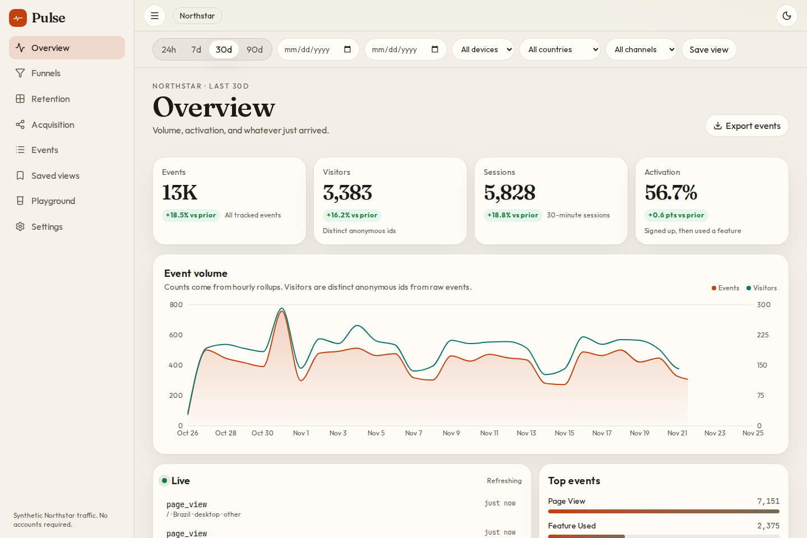
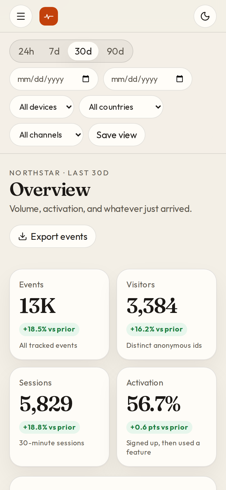
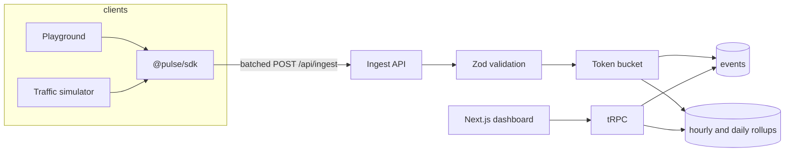
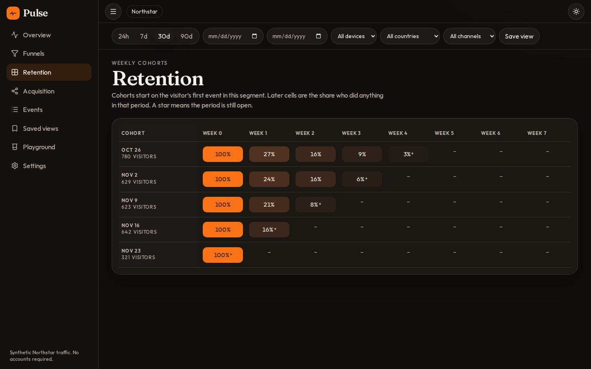

# Pulse

Product analytics for people who ship. Track events, watch them land, and answer the questions a product team actually asks: what happened, who converted, and who came back.


Pulse is a small, typed analytics platform built as a portfolio project by [Akhilendra Singh](https://github.com/AkhilSingh2). It tracks a fictional product, Northstar, with synthetic traffic. Nothing here calls a paid API.

## What you can do

- Drop in `@pulse/sdk` and send `page`, `track`, and `identify` from the browser or Node. Events batch, retry, and carry a stable anonymous id plus a 30-minute session.
- Ingest batches through `POST /api/ingest`: Zod validation, idempotent event ids, and a token-bucket rate limit.
- Store raw events in Postgres and maintain hourly and daily rollups on the write path.
- Read the warehouse through a typed tRPC API: KPIs, time series, funnels, retention cohorts, top pages and referrers, segment filters, date ranges, CSV export, and saved views.
- Watch a live stream. `npm run simulate` keeps posting traffic through the real SDK and ingest API, so the dashboard does not sit still.





## Architecture



Reads and writes are split on purpose. The SDK speaks a small JSON batch protocol. The dashboard speaks tRPC, so query inputs and results stay typed from the React hook to the SQL. Rollups answer event volume, top pages, and top referrers. Unique visitors, funnels, and retention stay on raw events, because you cannot sum uniques across buckets. The chart says which path it used.

Identity is the anonymous id. `user_id` is an attribute set by `identify`. Grouping on `coalesce(user_id, anonymous_id)` would split one person into two and invent funnel drop-off. That choice is documented in [docs/LEARNING.md](docs/LEARNING.md).

## Stack

| Piece | Choice |
| --- | --- |
| Monorepo | npm workspaces, Turborepo |
| App | Next.js, React, TypeScript |
| UI | Tailwind CSS, a small custom design system, Recharts |
| API | tRPC for reads, REST for ingest |
| Validation | Zod |
| Database | Postgres 16, SQL via Postgres.js |
| Tests | Vitest, Playwright |
| CI | GitHub Actions, with a Postgres service |

## Run it

You need Node 20+ and Docker.

```bash
cp .env.example .env
docker compose up -d
npm install
npm run db:setup
npm run dev
```

Open [http://localhost:3000](http://localhost:3000).

In another terminal, keep the live stream moving:

```bash
npm run simulate
```

`db:setup` migrates and seeds about two months of Northstar traffic: weekday and weekend shape, a launch spike, and a funnel from page view through subscription. The seed is deterministic (`seed` 2211) and skips if events are already stored. `SEED_FORCE=1 npm run db:seed` rebuilds it. `SEED_PROFILE=small` is the shorter set CI uses.

The demo API key in `.env` is `pulse_live_demo_northstar`. The settings page shows it so the browser SDK can post events. It is not a secret. Do not reuse it anywhere real.

Without Docker, point `DATABASE_URL` at any Postgres 16 database and run the same `db:setup`.

### Tests

```bash
npm run lint
npm run typecheck
npm run test
npm run test:e2e
```

Unit tests cover funnel math, retention cohorts, the token bucket, event validation, SDK batching, and the traffic generator. Integration tests, when `DATABASE_URL` is set, check that SQL funnels match the tested function and that rollup totals match raw counts. Playwright walks overview, funnels, retention, acquisition, theme, CSV export, saved views, ingest, and the mobile menu.

## Deploy later

No accounts are required to run Pulse locally.

```bash
docker compose --profile app up --build
```

That starts Postgres and the web container. The container migrates, seeds when the database is empty, and listens on port 3000.

A later deploy is a Node host plus managed Postgres. Set `DATABASE_URL` and `PULSE_API_KEY`. Put the app behind your own auth before it faces the public internet, and stop shipping the API key to the browser. The in-process rate limiter is per server; a multi-instance deploy should move the same token bucket to Redis. `.env.example` lists every variable. Nothing secret is committed.

## What this demonstrates

- An event pipeline with validation, batching, idempotency, and backpressure.
- Why rollups exist, what they cannot answer, and when a query should fall back to raw events.
- Funnel and retention definitions you can test without a database, then run on SQL-shaped data.
- A typed read API next to a boring, documented write API.
- A dashboard that stays readable in light and dark, on a phone, and with a keyboard.

The study guide, with exercises, is [docs/LEARNING.md](docs/LEARNING.md).

## Layout

```text
apps/web            Next.js dashboard, tRPC, ingest, CSV export
packages/sdk        @pulse/sdk
packages/shared     Zod schemas, funnel and retention math, rate limiter
packages/db         schema, queries, rollups, seed, simulator
```


